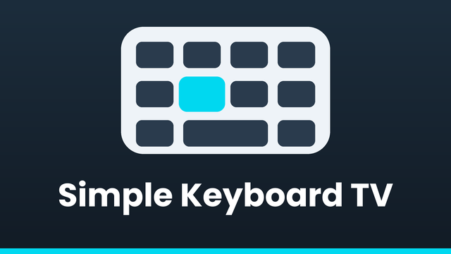
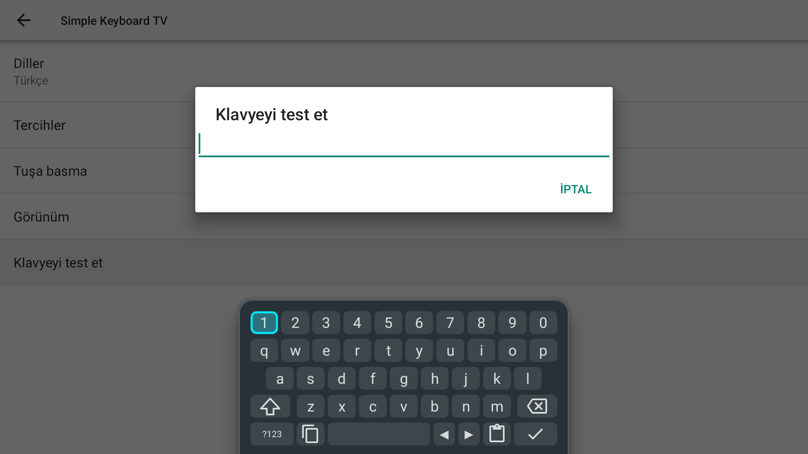
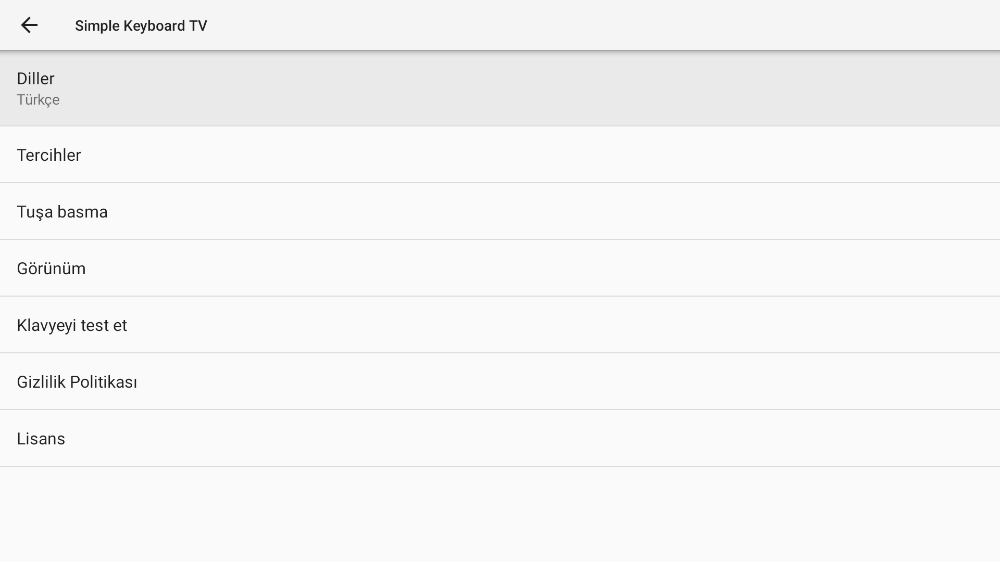

# Simple Keyboard TV

<p align="center">
  
</p>

A small on-screen keyboard for Android TV that you drive with the remote's D-pad.
It is an unofficial fork of [Simple Keyboard](https://github.com/rkkr/simple-keyboard) by rkkr, adapted for TVs.
No ads, no tracking, no Internet permission: the only permission it asks for is Vibrate.

<p align="center">
  
</p>

## Features

Added for TV:

- Navigate the keys with the D-pad and press OK to type, with a clear focus highlight on the active key
- The long-press alternatives popup (accents, symbols) also works with the D-pad
- Left/right cursor keys in the bottom row
- Copy and Paste keys in place of the comma and period keys (long-press Copy to copy all text)
- Centered compact keyboard in the style of Gboard on TV, or a floating card with a gap from the bottom edge
- Adjustable keyboard width, height and distance from the bottom edge
- Shows up in the TV launcher (Leanback) with its own icon and banner

Kept from Simple Keyboard:

- Small size: the release APK is under 1 MB
- Number row, custom theme colours, light/dark and bordered themes
- All upstream layouts and translations, including Turkish

Not included, and not planned: emoji, GIFs, spell checking, swipe typing, voice input.

<p align="center">
  
</p>

## Install

Download the APK from the Releases page, or [build it yourself](#build). Then, with network debugging
enabled on the TV:

```
adb connect <tv-ip>:5555
adb install -r app-release.apk
adb shell ime enable com.simplekeyboardtv.ime/rkr.simplekeyboard.inputmethod.latin.LatinIME
adb shell ime set com.simplekeyboardtv.ime/rkr.simplekeyboard.inputmethod.latin.LatinIME
```

Without adb you can enable it in the TV's settings under Device Preferences > Keyboard.
The exact menu name depends on the TV maker.

## Build

You need a JDK (17 or newer) and the Android SDK. Then:

```
./gradlew assembleRelease
```

The APK ends up in `app/build/outputs/apk/release/`. A release build is signed with the debug key,
which is fine for sideloading on your own TV. To sign with your own key, create `keystore.properties`
in the project root (it is git-ignored):

```
storeFile=/path/to/my.jks
storePassword=...
keyAlias=...
keyPassword=...
```

### Windows helper scripts

`scripts/` has batch files that build and install in one step. Copy `scripts/tv.example.txt` to
`scripts/tv.txt`, put your TV's `ip:port` in it, then run `scripts\build.bat` and `scripts\install.bat`.
`install.bat` also enables the keyboard and compiles it ahead of time for a faster first start.

### Regenerating the icon and banner

`python scripts/gen_icons.py` rebuilds the launcher icon, the monochrome icon, the TV banner and the preview
images from one set of shapes (needs Pillow).

## Notes

- Application ID: `com.simplekeyboardtv.ime`. The Java package is still `rkr.simplekeyboard.inputmethod`,
  as in upstream, which keeps merging upstream changes easy.
- Privacy: see [PRIVACY.md](PRIVACY.md).

## Credits and licence

Licensed under the [Apache License 2.0](LICENSE).

Based on [Simple Keyboard](https://github.com/rkkr/simple-keyboard) by Raimondas Rimkus (rkkr), which is based
on the AOSP LatinIME keyboard (https://android.googlesource.com/platform/packages/inputmethods/LatinIME/).
This project is not affiliated with or endorsed by the upstream project. Gboard is a trademark of Google LLC;
it is mentioned only to describe the layout style.
